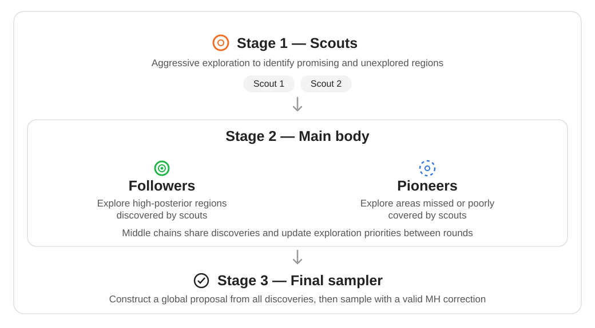
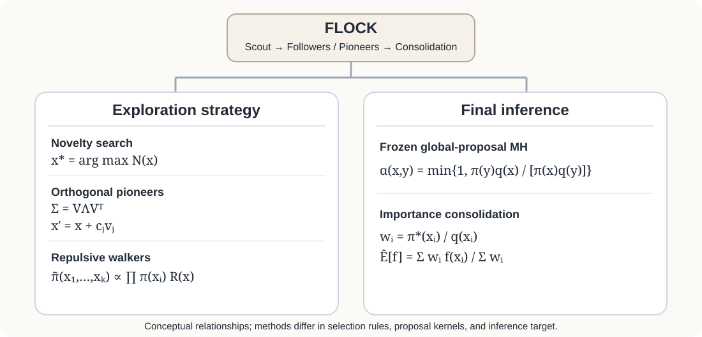
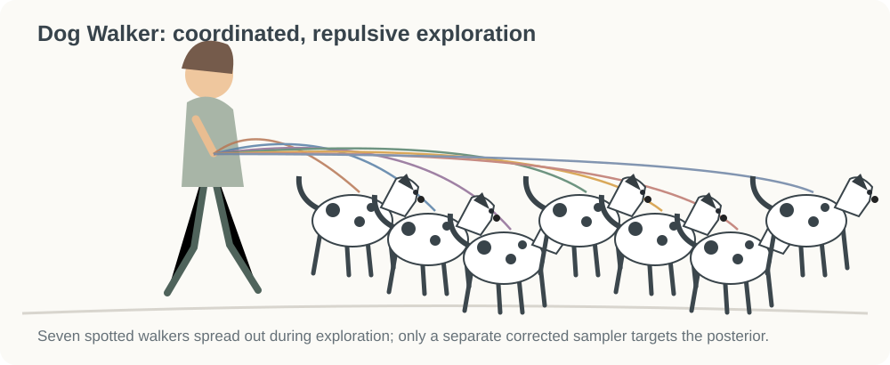
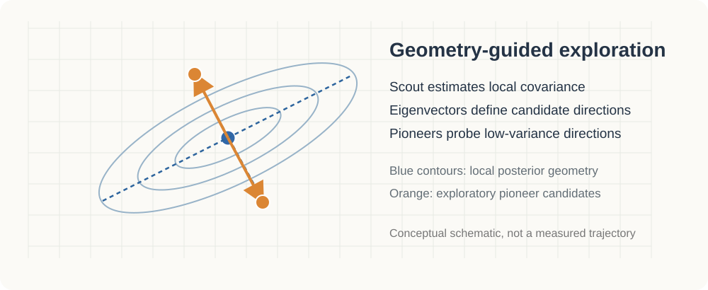

# FLOCK — role-specialized posterior exploration

**Archived exploratory research, October–November 2026. Not a validated MCMC algorithm.**

This repository documents an experimental idea: divide a fixed computation budget among **scouts**, **followers**, and **pioneers**. Learn from their discoveries to construct a proposal, then perform separately corrected posterior inference.




## Algorithm structure and variants

The *three-stage architecture* stays fixed: scout → role-specialized exploration → corrected inference. The experiments vary **how the middle-stage proposal is learned** and **how the final inference stage is performed**.



| Component | Defining idea |
|:--|:--|
| **Scout** | Adaptive MH estimates local structure and discovers plausible basins. |
| **Followers** | Exploit promising regions discovered by scouts. |
| **Pioneers** | Search for plausible regions that the existing exploratory histories may have missed. |
| **Final inference** | Freeze a global proposal $q$ and use a valid MH correction **or** draw fresh weighted importance samples. |

### Three complementary exploration mechanisms


**Novelty / unexplored search.** Pioneer starting points are screened for novelty relative to exploratory history, with variants using density plausibility, coverage, or diversity. Schematically, a candidate can be selected by maximizing a score $N(x;\mathcal H)$. The particular score changed between experiments.

**Orthogonal / geometric search.** The scout supplies an estimated covariance with eigendecomposition

$$
\widehat{\Sigma}=V\Lambda V^\top,\qquad
\theta'=\theta+c_jv_j.
$$

The low-variance eigenvectors suggest additional directions to probe; actual proposal steps are scaled, regularized, and capped. *SoftOrth* encourages rather than forces these directions. Local covariance does not identify missing modes automatically.

**Dog Walker / repulsive search.** The exploratory walkers target an **auxiliary** repulsive joint distribution, represented schematically by

$$
\widetilde{\pi}(x_1,\ldots,x_K)
\propto
\bigl[\prod_{k=1}^{K}\pi(x_k)\bigr]
\exp\bigl[-\sum_{i<j}\phi\{d(x_i,x_j)\}\bigr].
$$

Here $d$ is a standardized distance and $\phi$ is a nonnegative decreasing penalty, so close walkers are discouraged. The actual penalty and transition kernels depend on the archived version. **These exploratory trajectories are not posterior samples.** Experiments compared 65% versus 90% exploration, including no-repulsion controls.

<details>
<summary><strong>Visual inspirations: Dog Walker, geometric search, and bird formation</strong></summary>






The metaphors motivate different spatial roles; they are not proofs of posterior convergence. The Dog Walker idea comes from coordinated walking of several dogs, with repulsion used to encourage spatial diversity during exploration.

</details>

### Final inference: two distinct designs

**Global-proposal Metropolis–Hastings.** If $q$ is frozen after exploration and evaluated exactly, an independence proposal $y\sim q$ has acceptance probability

$$
\alpha(x,y)=\min\bigl\{1,\frac{\pi(y)q(x)}{\pi(x)q(y)}\bigr\}.
$$

This is an illustrative independence-MH correction; some historical final samplers also used local moves. Correctness of the transition kernel does **not** itself establish adequate mixing.

**Importance consolidation.** Alternatively, generate *fresh* $x_i\sim q$, compute weights using an unnormalized target $\pi^*$, and estimate posterior expectations:

$$
w_i=\frac{\pi^*(x_i)}{q(x_i)},\qquad
\widehat{\mathbb E}_{\pi}[f]
=\frac{\sum_{i=1}^{n}w_i f(x_i)}{\sum_{i=1}^{n}w_i}.
$$

This is a weighted estimator, **not** a final MCMC chain. A defensive broad proposal component helps with support but does not prevent weight degeneracy.

### Conceptual pseudocode

```python
# A research sketch, not an executable implementation
history = scout(log_posterior)

followers = refine(history)
pioneers  = explore(history, strategy="novelty | orthogonal | repulsive")
discoveries = combine(history, followers, pioneers)

q = fit_and_freeze_global_proposal(discoveries)

# Choose ONE of two different inference designs:
posterior_draws = corrected_mh(log_posterior, q)
# OR:
weighted_estimate = self_normalized_importance_sampling(log_posterior, q)
```

<details>
<summary><strong>Historical implementation variants and ablations</strong></summary>

- **Original FLOCK:** staged scout, followers, pioneers, and final sampling.
- **Random / followers-only:** change where middle-stage chains start.
- **Novelty / Unexplored / Density / Diversity:** change how potential pioneer starting locations are ranked.
- **Orthogonal / OrthogonalSoft:** use the scout covariance eigendirections, with stronger or softer directional encouragement.
- **Map / MapMerge:** summarize discovered regions and experiment with merging nearby local approximations.
- **FLOCK-AM / Staged-AM / FLOCK-RWMH:** compare directed middle-stage formation to undirected baselines while varying the local proposal kernel.
- **Dog Walker 65 / 90 / no-repulsion:** evaluate repulsion and exploration budget independently.
- **Importance FLOCK:** replace the final MH chain with independently weighted draws from a frozen mixture proposal.

These are algorithm variations; the Gaussian product, hierarchical funnel, and quadratic-sign simulations below are **target models used for testing**, not FLOCK variants.

</details>

**Central unresolved challenge:** more aggressive exploration can discover additional candidate regions, but it does not guarantee accurate posterior *mass allocation*. This is why the exploratory and inference stages must be distinguished.


## Promising results

The exploratory benchmarks identified several targets on which one FLOCK variant achieved lower estimation error than its specified comparator. The models are stated below so the simulations can be interpreted and reproduced; **these are not established general performance improvements**.

| Model | FLOCK configuration | Comparator | Reported mean error | Evidence |
|---|---|---|---|---|
| Hierarchical normal random effects (7D) | FLOCK-Orthogonal | Adaptive Metropolis | **0.062** vs 0.246 | 2 runs per method |
| Nonidentified Gaussian product model (2D) | FLOCK-Novelty | Adaptive Metropolis | **0.161** vs 0.283 | 2 runs per method |
| Sign-ambiguous quadratic Gaussian model (1D, bimodal posterior) | FLOCK-Novelty | Custom AdaptiveMixtureMH | **0.0113** vs 0.0500 mean absolute error in posterior mean | One archived benchmark, 96,000 log-target evaluations per method |
| Five-dimensional multimodal target (Experiment 3) | FLOCK-Unexplored | Custom AdaptiveMixtureMH | **1.901** vs 2.059 mean RMSE | 100 runs; paired interval includes zero |
| Importance-sampling consolidation pilot | FLOCK-Roles | Matched undirected proposal | **0.204** vs 0.325 reported mean RMSE | 10-run previously reported summary, **not independently verified** |

**Metrics differ:** the first two rows summarize standardized errors across selected posterior functionals, while the bimodal row is absolute error in the posterior mean. They are not directly comparable. The small 2-run pilots are descriptive, not robust demonstrations of superiority.

### Model 1: Hierarchical normal random effects (7D)

Six observed values were fixed to

$$
y=(-0.80,\;0.25,\;1.10,\;-0.55,\;0.65,\;-1.05).
$$

The fitted Bayesian model was

$$
t=\log \tau\sim N(-0.6,1^2), \qquad
\eta_i\mid t\stackrel{\mathrm{ind}}{\sim}N(0,e^{2t}),\qquad
y_i\mid\eta_i\stackrel{\mathrm{ind}}{\sim}N(\eta_i,2.3^2),
\quad i=1,\ldots,6.
$$

The unknowns are $t,\eta_1,\ldots,\eta_6$. When $t$ is small, the conditional random-effect distribution contracts sharply, creating a funnel-shaped posterior. The reference for $t$ uses the analytically integrated model $y_i\mid t\sim N(0,e^{2t}+2.3^2)$, followed by one-dimensional numerical integration. The benchmark scored the posterior mean of $t$, $P(t>0\mid y)$, $E(\eta_1\mid y)$, and $E(\eta_1^2\mid y)$, each with a fixed error scale. **The event $t>0$ is a tail event, not a second posterior mode.**

### Model 2: Nonidentified Gaussian product model (2D)

With independent priors $\theta_1,\theta_2\sim N(0,3^2)$, the likelihood was

$$
y_i\mid\theta_1,\theta_2\stackrel{\mathrm{ind}}{\sim}
N(\theta_1\theta_2,0.7^2),
\quad i=1,\ldots,6.
$$

The data were generated with R seed **101** by $\texttt{rnorm(6, mean=3.7, sd=0.7)}$. Only the product $\theta_1\theta_2$ is directly informed by the likelihood, yielding sign-symmetric, curved posterior branches under the prior. The accuracy score aggregates scaled errors for $E(\theta_1^2\mid y)$, $E(\theta_2^2\mid y)$, $E(\theta_1\theta_2\mid y)$, and $P(\theta_1>0\mid y)$. Reference expectations were obtained by analytically integrating out $\theta_2$ conditional on $\theta_1$, then numerically integrating over $\theta_1$.

### Model 3: Sign-ambiguous quadratic Gaussian model (bimodal posterior, 1D)

This is the **exact Bayesian data-generating and fitted model** for the bimodal row, not a generic two-Gaussian mixture:

$$
\theta_{\mathrm{true}}=3,\qquad
y_i\mid\theta\stackrel{\mathrm{ind}}{\sim}N(\theta^2,1),
\quad i=1,\ldots,12,\qquad
\theta\sim N(2,3^2).
$$

The experiment simulated $y_i\stackrel{\mathrm{ind}}{\sim}N(9,1)$ using R seed **20261025**. Because $\theta^2=(-\theta)^2$, the likelihood cannot identify the sign of $\theta$. The prior favors positive values, so the two posterior modes near $-3$ and $+3$ generally have **unequal mass**. Up to a normalizing constant, the posterior is

$$
p(\theta\mid y)\propto
\exp\bigl[-\frac{12}{2}(\theta^2-\bar{y})^2\bigr]
\exp\bigl[-\frac{(\theta-2)^2}{2\cdot3^2}\bigr].
$$

An accurate numerical reference posterior was computed by trapezoidal integration over 12,001 equally spaced grid points on $[-9,9]$. The archived comparison used eight independent final runs per method, each with a **12,000-target-evaluation budget** (96,000 across runs). The table's 0.0113 versus 0.0500 compares **mean absolute error of the estimated posterior mean** versus that reference; it is **not** the RMSE of entire posterior distributions. The corresponding mean absolute errors in $P(\theta>0\mid y)$ were **0.00188** (FLOCK-Novelty) and **0.00844** (custom AdaptiveMixtureMH). A single seeded simulated dataset and this benchmark do not establish a general win.

The simulator and frozen-final-proposal implementation are preserved in the historical source `scripts/flock_dogwalker_theta2.R` (see [archive inventory](ARCHIVE_INVENTORY.md)). 

### Important limitations

For Models 1 and 2, the archived comparison used **only two replicates per algorithm**, so the apparent improvements are highly uncertain. The Adaptive Metropolis comparator was a local covariance-adaptive implementation, not a fully tuned global mixture sampler. The exploratory importance-sampling pilot used a different final estimator, and its reported summary was not independently verified. See [RESULTS_PROVENANCE.md](RESULTS_PROVENANCE.md).

## Findings

- Direction-aware, role-specialized exploration did **not consistently improve** performance relative to simpler benchmarks.
- The scout/follower/pioneer distinction may improve discovery without producing correctly weighted posterior estimates.
- Importance-based consolidation avoids requiring one final chain to move among all modes, but introduces potentially severe weight degeneracy.
- Mode discovery, mode-weight recovery, estimator error, and computational cost must be assessed separately.

## Source material

See [ARCHIVE_INVENTORY.md](ARCHIVE_INVENTORY.md) for 14 historical R scripts and recovered outputs. Some archival materials have not yet been committed as individual files. The code is historical, not audited or rerun for this publication.

**Manuscript withheld for review:** `main.tex` and `main.pdf` are intentionally absent.

No license has been assigned.
