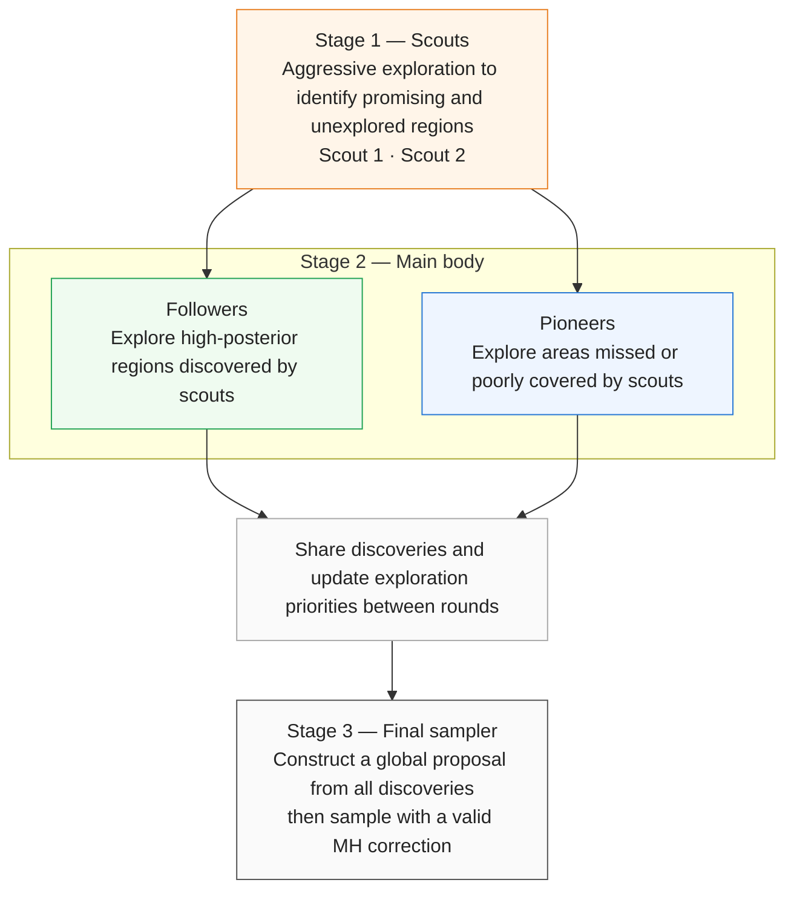

# FLOCK — role-specialized posterior exploration

**Archived exploratory research, October–November 2026. Not a validated MCMC algorithm.**

This repository documents an experimental idea: divide a fixed computation budget among **scouts**, **followers**, and **pioneers**. Learn from their discoveries to construct a proposal, then perform **separately corrected posterior inference**.

## Conceptual structure

**The final stage was the central unresolved challenge.** Exploratory states are not automatically posterior draws. A properly constructed MH transition can correct a frozen proposal in principle, but the quality of the learned proposal and resulting estimation accuracy still have to be established. Importance-weighted consolidation was examined separately and is not equivalent to a corrected final MH chain.

## Historical experiment highlights

| Study | Comparison | Interpretation |
|---|---|---|
| Experiment 2 (100 runs) | Targeted mean RMSE 2.192 vs random 2.032 | Directional exploration did not outperform random |
| Experiment 3 (100 runs) | Unexplored 1.901 vs adaptive mixture MH 2.059 | Paired difference interval included zero |
| Experiment 4 (100 runs) | Novelty functional RMSE 0.01477 vs adaptive mixture MH 0.01525 | Small difference; no general superiority |
| Experiment 5 (25 complete visible runs) | Novelty 0.391 vs AM 0.491 | Only 11 of 25 pairs favored Novelty; full results missing |
| Importance pilot (previously reported 10 runs) | Roles 0.204 vs undirected 0.325 | **Unverified** prior report; importance sampling, not MH |

**Warning:** different experiments use different targets and RMSE definitions; do not compare magnitudes across rows. Evidence grades and limitations are in [RESULTS_PROVENANCE.md](RESULTS_PROVENANCE.md).

## Findings

- Direction-aware, role-specialized exploration did **not consistently improve** performance relative to simpler benchmarks.
- The scout/follower/pioneer distinction may improve discovery without producing correctly weighted posterior estimates.
- Importance-based consolidation avoids requiring one final chain to move among all modes, but introduces potentially severe weight degeneracy.
- Mode discovery, mode-weight recovery, estimator error, and computational cost must be assessed separately.

## Source material

See [ARCHIVE_INVENTORY.md](ARCHIVE_INVENTORY.md) for 14 historical R scripts and recovered outputs. Some archival materials have not yet been committed as individual files. The code is historical, not audited or rerun for this publication.

**Manuscript withheld for review:** `main.tex` and `main.pdf` are intentionally absent.

No license has been assigned.