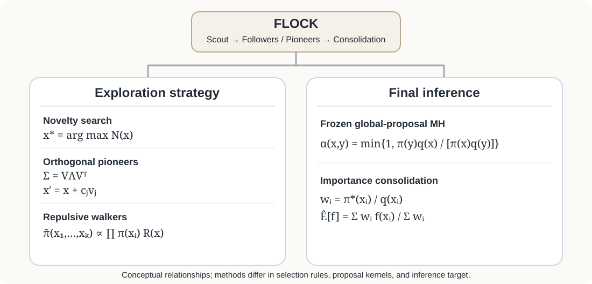
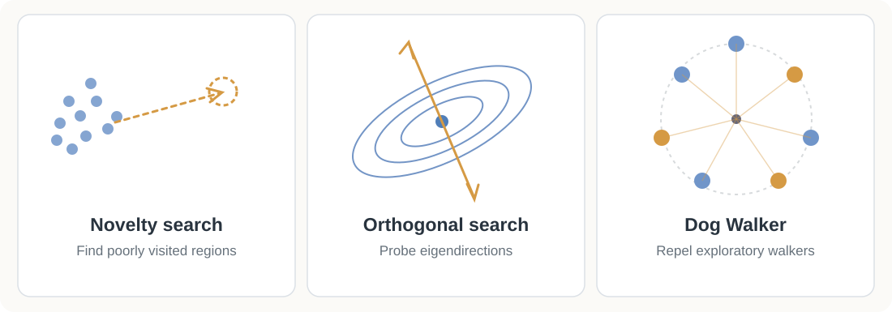
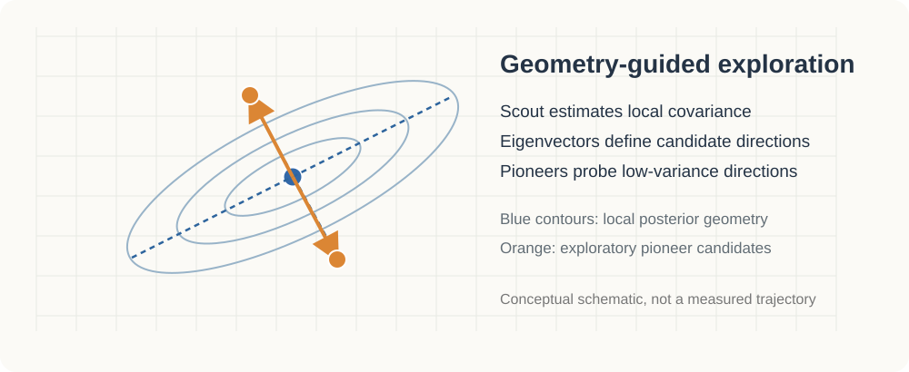
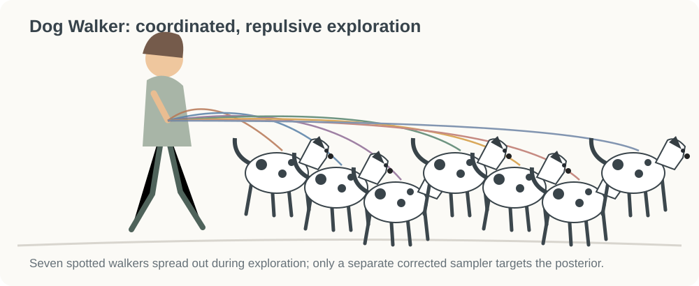

# Algorithm design and variants

The *three-stage architecture* stays fixed: scout → role-specialized exploration → corrected inference. The experiments vary **how the middle-stage proposal is learned** and **how the final inference stage is performed**.



| Component | Defining idea |
|:--|:--|
| **Scout** | Adaptive MH estimates local structure and discovers plausible basins. |
| **Followers** | Exploit promising regions discovered by scouts. |
| **Pioneers** | Search for plausible regions that the existing exploratory histories may have missed. |
| **Final inference** | Freeze a global proposal $q$ and use a valid MH correction **or** draw fresh weighted importance samples. |

### Three complementary exploration mechanisms



**Novelty / unexplored search.** Pioneer starting points are screened for novelty relative to exploratory history, with variants using density plausibility, coverage, or diversity. Schematically, a candidate can be selected by maximizing a score $N(x;\mathcal H)$. The particular score changed between experiments.

**Orthogonal / geometric search.** The scout supplies an estimated covariance with eigendecomposition

$$
\widehat{\Sigma}=V\Lambda V^\top,\qquad
\theta'=\theta+c_jv_j.
$$

The low-variance eigenvectors suggest additional directions to probe; actual proposal steps are scaled, regularized, and capped. *SoftOrth* encourages rather than forces these directions. Local covariance does not identify missing modes automatically.

<p align="center">
  
</p>

**Dog Walker / repulsive search.** The exploratory walkers target an **auxiliary** repulsive joint distribution, represented schematically by

$$
\widetilde{\pi}(x_1,\ldots,x_K)
\propto
(\prod_{k=1}^{K}\pi(x_k))
\exp\left(-\sum_{i=1}^{K-1}\sum_{j=i+1}^{K}\phi(d(x_i,x_j))\right).
$$

Here $d$ is a standardized distance and $\phi$ is a nonnegative decreasing penalty, so close walkers are discouraged. The actual penalty and transition kernels depend on the archived version. **These exploratory trajectories are not posterior samples.** Experiments compared 65% versus 90% exploration, including no-repulsion controls.

<p align="center">
  
</p>


### Final inference: two distinct designs

**Global-proposal Metropolis–Hastings.** If $q$ is frozen after exploration and evaluated exactly, an independence proposal $y\sim q$ has acceptance probability

$$
\alpha(x,y)=\min\{1,\frac{\pi(y)q(x)}{\pi(x)q(y)}\}.
$$

This is an illustrative independence-MH correction; some historical final samplers also used local moves. Correctness of the transition kernel does **not** itself establish adequate mixing.

**Importance consolidation.** Alternatively, generate *fresh* $x_i\sim q$, compute weights using an unnormalized target $\pi^*$, and estimate posterior expectations:

$$
w_i=\frac{\pi^*(x_i)}{q(x_i)},\qquad
\widehat{\mathbb E}_{\pi}[f]
=\frac{\sum_{i=1}^{n}w_i f(x_i)}{\sum_{i=1}^{n}w_i}.
$$

This is a weighted estimator, **not** a final MCMC chain. A defensive broad proposal component helps with support but does not prevent weight degeneracy.

### Conceptual pseudocode

```python
# A research sketch, not an executable implementation
history = scout(log_posterior)

followers = refine(history)
pioneers  = explore(history, strategy="novelty | orthogonal | repulsive")
discoveries = combine(history, followers, pioneers)

q = fit_and_freeze_global_proposal(discoveries)

# Choose ONE of two different inference designs:
posterior_draws = corrected_mh(log_posterior, q)
# OR:
weighted_estimate = self_normalized_importance_sampling(log_posterior, q)
```

<details>
<summary><strong>Historical implementation variants and ablations</strong></summary>

- **Original FLOCK:** staged scout, followers, pioneers, and final sampling.
- **Random / followers-only:** change where middle-stage chains start.
- **Novelty / Unexplored / Density / Diversity:** change how potential pioneer starting locations are ranked.
- **Orthogonal / OrthogonalSoft:** use the scout covariance eigendirections, with stronger or softer directional encouragement.
- **Map / MapMerge:** summarize discovered regions and experiment with merging nearby local approximations.
- **FLOCK-AM / Staged-AM / FLOCK-RWMH:** compare directed middle-stage formation to undirected baselines while varying the local proposal kernel.
- **Dog Walker 65 / 90 / no-repulsion:** evaluate repulsion and exploration budget independently.
- **Importance FLOCK:** replace the final MH chain with independently weighted draws from a frozen mixture proposal.

These are algorithm variations; the Gaussian product, hierarchical funnel, and quadratic-sign simulations below are **target models used for testing**, not FLOCK variants.

</details>

**Central unresolved challenge:** more aggressive exploration can discover additional candidate regions, but it does not guarantee accurate posterior *mass allocation*. This is why the exploratory and inference stages must be distinguished.


---

This section documents exploratory prototypes, not a validated sampler. Individual implementations may differ from the schematic equations.
